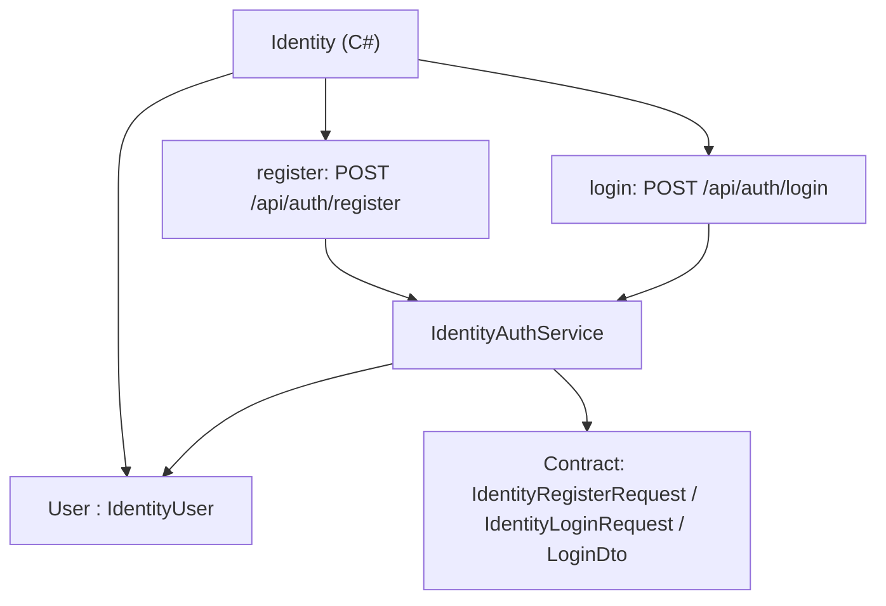

# Identity (C#): конспект

Схема з конспекту (Excalidraw) і кроки 1–7 зі скріншота відтворені в проєкті.

## Кроки з конспекту і файли, що їх реалізують

| Крок | Що зроблено | Файл |
|---|---|---|
| 1 | `IdentityLoginRequest` з полями `Login`, `Password` | `WebApplication1/Contracts/IdentityLoginRequest.cs` |
| 2 | Валідатор: `Login` 5–50 символів, `Password` 6–100 | `WebApplication1/Validations/IdentityLoginRequestValidator.cs` |
| 3 | `LoginDto` (`Login`, `Password`) | `Cinema.Business/Dtos/LoginDto.cs` |
| 4 | `ValidateUserCredentialsAsync(LoginDto)`: `FindByNameAsync`, якщо `null` то `false`, інакше `CheckPasswordAsync` | `Cinema.Business/Services/IdentityAuthService.cs` |
| 5 | Немає тексту на скріншоті | - |
| 6 | Мапінг `IdentityLoginRequest` <-> `LoginDto` з `ReverseMap` | `WebApplication1/Mapping/MappingProfile.cs` |
| 7 | `[HttpPost("login")]`: валідація (`BadRequest(Errors)`), мапінг у `LoginDto`, `Ok(bool)` | `WebApplication1/Controllers/AuthController.cs`, метод `Login` |

Рядки `LoginRequest -> UserDto` і `UserResponce -> UserDto` у кроці 6 перекреслені на скріншоті, тому їх не додано. У проєкті немає `UserDto`, а `User` мапиться в `UserResponse` напряму.

## Потік реєстрації

1. `AuthController.Register` валідує `IdentityRegisterRequest` (FluentValidation).
2. `IdentityAuthService.EmailExistsAsync` перевіряє унікальність email (409 при дублікаті).
3. `AutoMapper` створює `User` з контракту без поля пароля.
4. `IdentityAuthService.RegisterAsync` ставить `UserName = Email` і викликає `UserRepository.CreateAsync`.
5. `UserManager<User>.CreateAsync` хешує пароль і зберігає користувача в `AspNetUsers`.

## Потік входу

1. `AuthController.Login` валідує `IdentityLoginRequest`. Помилки валідації повертаються з 400.
2. Контролер мапить запит у `LoginDto`.
3. `IdentityAuthService.ValidateUserCredentialsAsync` шукає користувача за `UserName` (`FindByNameAsync`) і перевіряє пароль через `CheckPasswordAsync`.
4. Відповідь 200 з `true` або `false`. Неіснуючий логін і невірний пароль дають однаковий `false`.

## Примітки

- Логін у проєкті це `UserName`, а `UserName` дорівнює email (він унікальний у Identity). Тому в поле `Login` вводять email.
- Пароль ніколи не зберігається у відкритому вигляді: `PasswordHash` містить хеш Identity.
- Сесій і JWT ще немає, це наступний етап. Відповідь `bool` означає лише результат перевірки, без токена.
- Крок 5 на скріншоті відсутній, тож його немає і в цьому документі.
